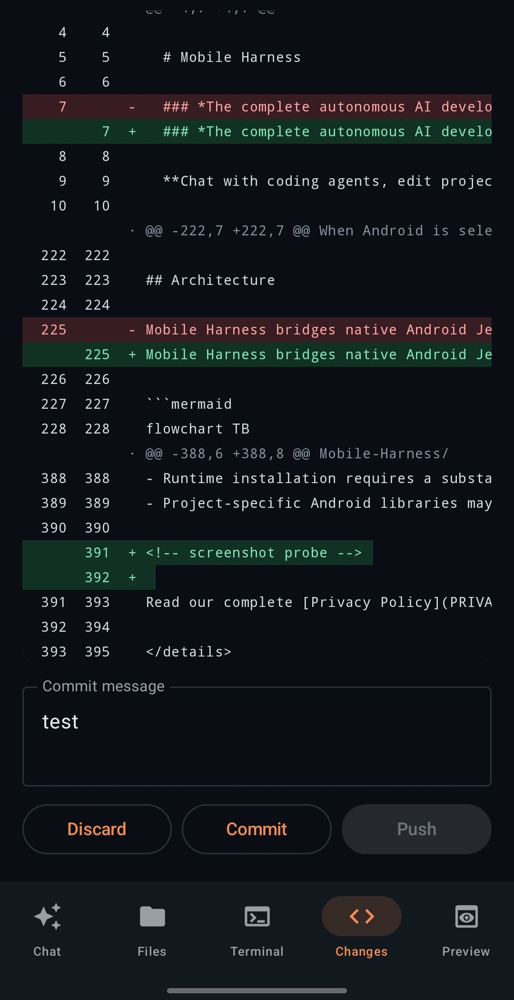
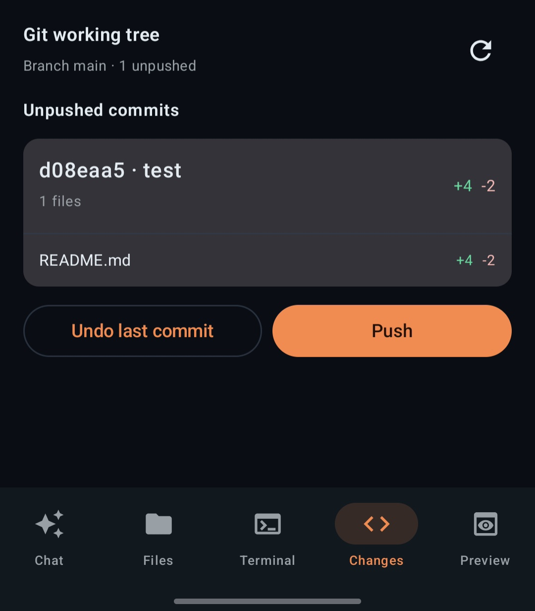
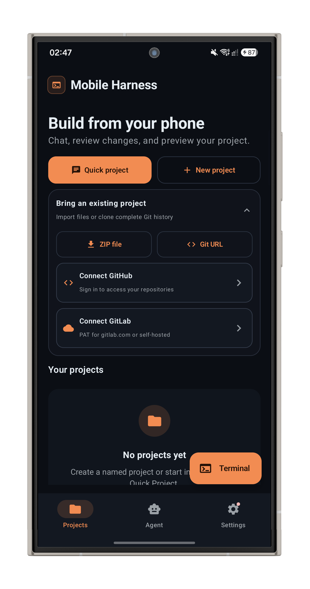
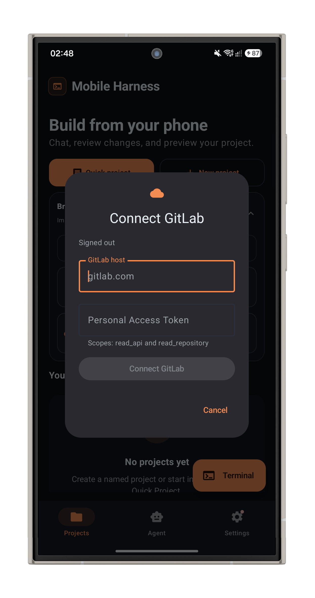

# Changelog

Notable changes in this fork of [Mobile Harness](https://github.com/techjarves/Mobile-Harness).

Follows [Keep a Changelog](https://keepachangelog.com/en/1.1.0/). Versions track the upstream app (`versionName` / `versionCode`); fork notes stay under **Unreleased** until tagged.

In-app **What's New** (`strings_whats_new.xml`) is separate — update it only when shipping an APK. This file is the source of truth for the fork.

## [Unreleased]

### Added

**Git changes on the Changes tab**

Review the real git working tree beside AI Undo/Keep: select files, preview diffs, discard, commit, and push (GitHub via `gh`, GitLab via stored PAT / askpass). Unpushed commits list hash, message, per-file `+/-`, with undo (soft reset). Hidden when the project has no `.git`.

<table>
  <tr>
    <th width="50%" align="center">Working tree</th>
    <th width="50%" align="center">Unpushed</th>
  </tr>
  <tr>
    <td align="center" valign="top">
      
    </td>
    <td align="center" valign="top">
      
    </td>
  </tr>
  <tr>
    <td align="center">Select files, expand diffs, Discard / Commit / Push</td>
    <td align="center">Inspect unpushed commits, undo last, then push</td>
  </tr>
</table>

**GitLab import (custom host + PAT)**

Bring existing private GitLab projects into Mobile Harness:

- Personal Access Token stored in the encrypted vault (never in prefs or remote URLs)
- Self-hosted hosts supported (e.g. `gitlab.example.com`), not only `gitlab.com`
- Clone via temporary `GIT_ASKPASS` inside the Linux workspace

<table>
  <tr>
    <th width="50%" align="center">Connect GitLab</th>
    <th width="50%" align="center">Host &amp; token</th>
  </tr>
  <tr>
    <td align="center" valign="top">
      
    </td>
    <td align="center" valign="top">
      
    </td>
  </tr>
  <tr>
    <td align="center">New <b>Connect GitLab</b> entry in Bring existing project</td>
    <td align="center">Host + Personal Access Token</td>
  </tr>
</table>

### Fixed

- Agent sessions no longer abort on mid-stream Claude Code `api_retry` / auth noise. Fatal auth and rate-limit reasons are classified only after the final `result` or a non-zero exit; the CLI is torn down on failure.
- DeepSeek Harness and Antigravity: rate-limit messages are distinct from rejected API key / out-of-credits (localized Antigravity rate-limit text).

### Added

**Git working tree on Changes**

- Real `git status` / per-file diff beside AI Undo/Keep
- Select files, commit message, Commit / Commit & push
- GitHub push via connected `gh`; GitLab via stored PAT + askpass
- Secret-path warning and local `user.name` / `user.email` prompt when needed

### Planned

- Branch switcher on the open project
- Multiple Git remotes / accounts (GitLab hosts + PATs)

## [Upstream 1.0.10]

Baseline of this fork (`19ea1b5`).
